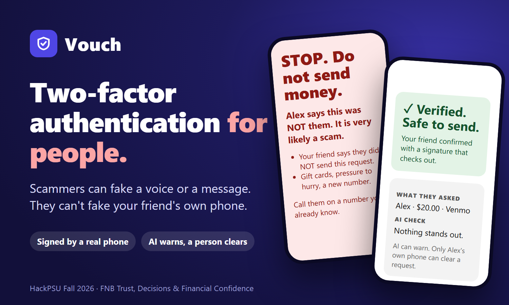
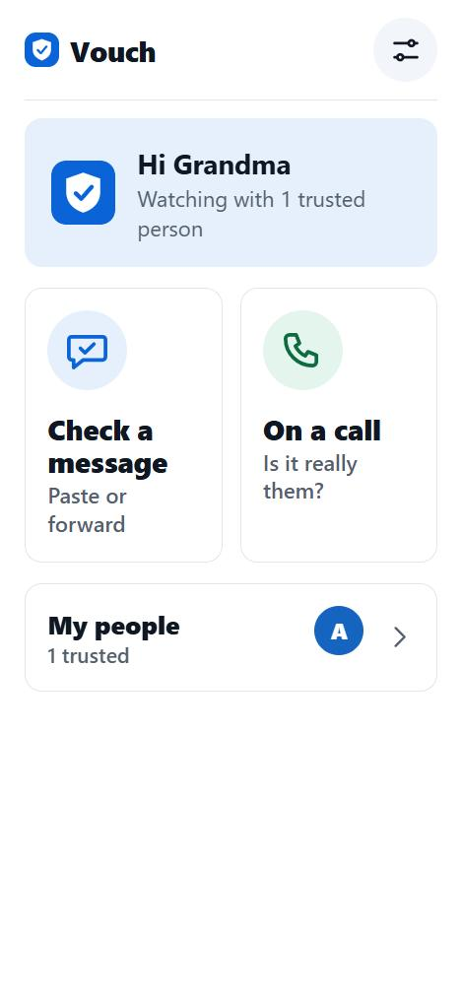
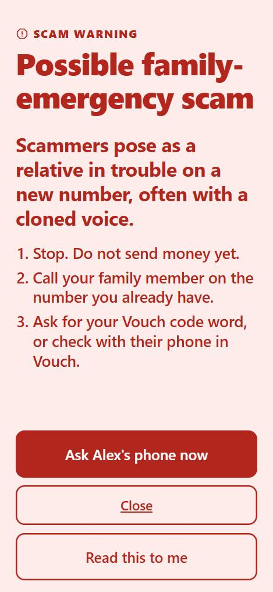
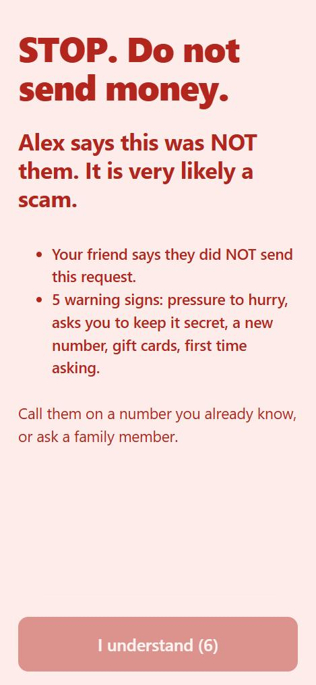
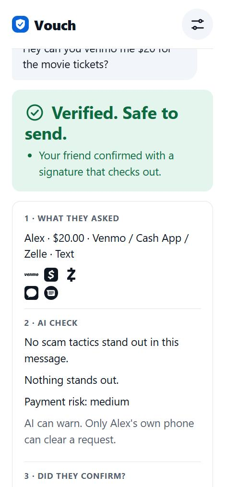
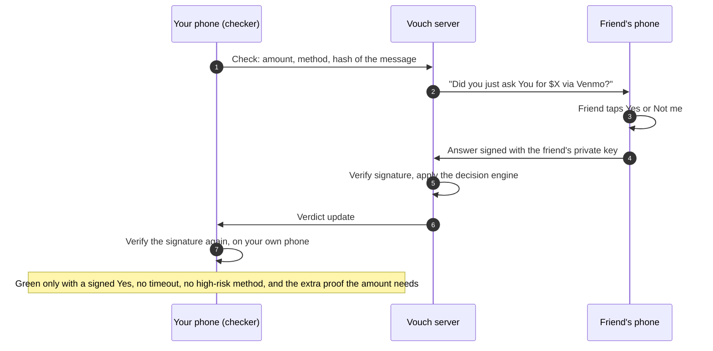
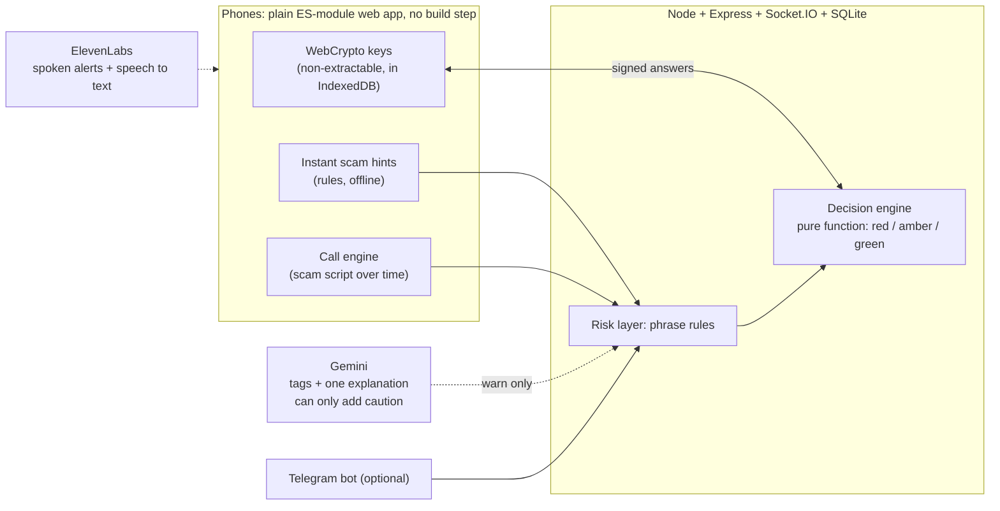

<div align="center">



# Vouch

**Scammers can fake a voice. They can't fake your friend's phone.**

Two-factor authentication for people: before you send money, your friend's own phone confirms they really asked,
with an answer signed by a key that never leaves that phone.

**Built during HackPSU Fall 2026.**

[](#the-team)
[](#why-it-fits-the-fnb-track)
[](#run-it)
[](#run-it)
[-1a73e8)](#how-it-works)
[](#how-it-works)
[](LICENSE)

**[Try the live app](https://vouch-co1l.onrender.com)** · **[Watch the demo video](https://youtu.be/3Ak9R70_H0s)** · **[Devpost](https://devpost.com/software/vouch-ai-4q21u7)** · **[Demo script](docs/DEMO.md)** · **[Live-call scenes](docs/LIVE-CALL-SCENES.md)** · **[Judge playbook](docs/JUDGE-PLAYBOOK.md)**

</div>

> [!NOTE]
> The first load of the live app can take up to a minute if the free host has been asleep. Pairings are stored in a temporary file on the free plan, which is erased when the server sleeps, restarts or redeploys, so everyone has to pair again.

## The problem

A voice, a phone number and a polished message used to be proof of who was asking. They aren't any more: AI can clone a voice in seconds, and numbers can be spoofed. The FTC reported that consumers lost more than $12.5 billion to fraud in 2024, and $2.95 billion of that was imposter scams ([source](https://www.ftc.gov/news-events/news/press-releases/2025/03/new-ftc-data-show-big-jump-reported-losses-fraud-125-billion-2024); reported losses only). Detecting fakes is a losing arms race, so Vouch checks the *person* instead of the message.

## Two kinds of scam, two defences

| Someone pretending to be... | What Vouch does | The proof |
| --- | --- | --- |
| **A person you know** (a "grandchild in trouble", a boss, a friend) | Asks that person's real, paired phone: *"Did you just ask Grandma for $200?"* | Their Yes or Not me is **signed** with a non-extractable key. Both the server and your phone verify the signature before anything turns green. |
| **An organisation or stranger** (a "bank" asking for a code, a fake delivery link, remote access, a job-ID request) | Warns in plain words while it is happening, names the dangerous request, and says what to do | Rules run on the phone with no AI; Gemini can add an explanation. It can only add caution. |

<table>
<tr>
<td align="center" width="25%"><br><sub>Home: check a message, or a call</sub></td>
<td align="center" width="25%"><br><sub>A plain warning with three steps</sub></td>
<td align="center" width="25%"><br><sub>Friend says Not me: STOP</sub></td>
<td align="center" width="25%"><br><sub>Signed Yes: Verified</sub></td>
</tr>
</table>

### How a friend check works



More money asks for more proof:

| Amount | What it takes to go green |
| --- | --- |
| Under $25 | A signed Yes |
| Up to $200 | A signed Yes, the retyped amount, and the rotating code word |
| Over $200 | All of that, plus a second trusted person |
| Gift cards, wires, crypto | Never green on a Yes alone |

## How it works



<details>
<summary><b>The rules we hold ourselves to</b></summary>

* **AI can warn, only a person can clear.** No AI output ever produces a verdict. Gemini can raise a warning, never lower one or clear a request.
* **The server is the source of truth,** and your own phone double-checks every signature.
* **Private keys are non-extractable** and never leave the phone. Keys, secrets, signatures and message text are never logged.
* **Every AI call has a 3-second timeout and a rule-based fallback.** With no key and no connection, the phone's own rules still warn about a suspicious message.
* **The server stores no message text, audio or images.** It keeps a SHA-256 of the normalised text, the amount, the method, the tags and the answer.
* **Rotating code word.** Paired phones derive the same two-word phrase every minute from a secret the server never sees. On a live call you ask "What's our word?".

</details>

## What you can try

<details open>
<summary><b>Scams to throw at it</b> (all fictional; more in <a href="docs/DEMO-MESSAGES.md">docs/DEMO-MESSAGES.md</a>)</summary>

| Try this | What Vouch does |
| --- | --- |
| *"Hi Grandma it's me, new number. I need $200 in Apple gift cards, please don't tell Mom."* | Flags a possible family-emergency scam. Check with the friend's phone: **Not me** gives a full-screen STOP. |
| *"We sent a 6 digit code to your phone. Please read it to me to cancel the fraudulent login."* | Red line: a real bank never asks you to read out a code. |
| A "First Harbor Bank" call that never uses a banned word: unusual activity, then your date of birth, then "move your funds to a protected account", then "read me the code" | **Noticing** on the first line, **STOP** by the third. See [LIVE-CALL-SCENES.md](docs/LIVE-CALL-SCENES.md). |
| *"Your account is on hold. Confirm your password at netflix-billing-help.com/verify."* | Warns: real companies never ask you to confirm a password from a message. |
| *"dinner at 7? can you pick up the drinks?"* | Nothing. It should not cry wolf. |

</details>

<details>
<summary><b>Live calls</b>: what "Listen for scams" does</summary>

On a call that is on speaker, Vouch turns the speech into words (the browser's own recognition, or Vouch's server for iPhone and when the browser cannot) and scores the call as a **script that unfolds in stages**: someone claims to be an official, frightens or rushes you, isolates you ("don't tell anyone", "stay on the line"), and only then asks for a code, card details, remote access or a "safe account". A few red lines are an immediate STOP; a real bank saying "we will never ask for your PIN" counts in your favour. The AI read can raise the level; it can never lower it. The warning names the sentence that triggered it and gives three steps. See [docs/LIVE-CALL-DEMO.md](docs/LIVE-CALL-DEMO.md) and [docs/CALL-TEST-LOG.md](docs/CALL-TEST-LOG.md).

> [!WARNING]
> Some phones block the microphone during a real call. Use speaker with a second phone, or the typed fallback. Live listening has been tried on staged calls, not at scale.

</details>

## Why it fits the FNB track

*Trust, Decisions & Financial Confidence.* The **decision** is a person's signed answer, not a score. The **trust** comes from a key that never leaves the friend's phone and a second check on your own. The **confidence** comes from warnings written in plain, calm words for someone who is scared in the middle of a call, with one clear next step.

## The team

| Who | Built |
| --- | --- |
| **Shivaan** | Backend, decision engine, deployment |
| **Sayan** | Phone app, crypto, the Watch bot and call engine |
| **Tejasv** | Risk rules, Gemini layer, tests, demo and story |

## Run it

Needs Node 20 or newer.

```bash
npm install
cp .env.example .env   # optional: add GEMINI_API_KEY to turn on the Gemini explanations
npm run dev            # http://localhost:3000 (core server)
node bot/serve.js      # the full app: AI read, call listening, spoken alerts, Telegram bot (loads .env)
npm test               # 344 tests
```

Phones need HTTPS for keys and camera, so test on real phones with `cloudflared tunnel --url http://localhost:3000` or the deployed URL. Step-by-step phone testing: [web/dev/TESTING.md](web/dev/TESTING.md). Deploying: [server/DEPLOY.md](server/DEPLOY.md). Server details: [server/API.md](server/API.md).

Without `GEMINI_API_KEY` the risk layer runs on rules only. Verdicts can only differ in one direction: Gemini may make a verdict more cautious (for example by spotting a gift-card request inside a screenshot, which the phrase rules cannot read), never less, and it can never clear a request.

## Where things are

| Path | What |
| --- | --- |
| [docs/PROTOCOL.md](docs/PROTOCOL.md) | The contract between phones and server (events, signed strings, tiers) |
| [docs/contracts.md](docs/contracts.md) | The risk layer's contracts: tags, payment risk, `analyze()`, `decide()` |
| `server/src/` | Express + Socket.io + SQLite server; `decision.js` turns answers into red, amber or green |
| `server/src/risk/` | `rules.js` (phrase and payment rules) and `gemini.js` (optional AI tags and explanation) |
| `web/` | The phone app: plain ES modules, no build step |
| `bot/` | Optional Vouch Watch: Telegram, SMS and WhatsApp (via Twilio) and live-call listening, started with `node bot/serve.js`; see [bot/README.md](bot/README.md) |
| `demo/` | Demo cue cards, clip lines and the voice-consent template (the audio files are git-ignored) |
| [docs/DEMO.md](docs/DEMO.md) | The 80-second demo script |
| [docs/LIVE-CALL-DEMO.md](docs/LIVE-CALL-DEMO.md), [docs/LIVE-CALL-SCENES.md](docs/LIVE-CALL-SCENES.md) | The two live calls: scripts, expected reactions, setup and test checklist |
| [docs/JUDGE-PLAYBOOK.md](docs/JUDGE-PLAYBOOK.md), [docs/JUDGE-SCRIPT.md](docs/JUDGE-SCRIPT.md) | What a judge might try, and what we say |
| [docs/DEMO-MESSAGES.md](docs/DEMO-MESSAGES.md), [docs/FILMING-GUIDE.md](docs/FILMING-GUIDE.md) | Fictional scam messages and how we film the demo |

## Privacy

The server never stores or logs message text, audio or screenshots. For each request it keeps a SHA-256 of the normalized text, the amount, method, tags and the one-line AI summary (not the message). When a Gemini key is set, pasted text, an attached screenshot and, in some modes, call words or call audio are sent to Google's Gemini API for analysis. When a flagged message comes from a visible Telegram sender, their profile picture may also be sent to Gemini to check whether it looks AI-generated (a hint, not proof). If an ElevenLabs key is set, voice notes and call audio are sent to ElevenLabs to be turned into words, and the spoken alerts send ElevenLabs only four fixed phrases (never your message, a name or an amount). Vouch does not store them. Gemini can only add warnings or make a verdict more cautious; it can never clear a request.

**Check screen.** The scam hints that flash on the phone run on the phone itself. If the server runs the Watch service with a Gemini key (`node bot/serve.js`), the app also sends what you type or paste (12 characters or more) to the Vouch server a moment after you stop typing, for an instant AI read: it goes to Gemini and is not stored. Otherwise text only leaves the phone when you tap Check now. If you use Android Share or the iPhone Shortcut instead, the message arrives in the web address (`/?text=...`): the app clears it from the browser right away and the Vouch server does not log web addresses, but the web host or tunnel in front of it may see it in its own request logs. Copy and paste avoids that.

**Call watcher (optional, off until you tap Listen to this call).** It works on a call that is on speaker, and turns speech into words in one of two ways. (1) Your browser's built-in speech recognition: the browser's own speech service may process the audio on its provider's servers, which depends on the browser and phone. (2) Listening through Vouch, used when the browser cannot listen, stops working, or on iPhone, where the browser's recognition is unreliable (needs a server running Watch with a Gemini or ElevenLabs key): the phone sends short audio clips of about 6 seconds to the Vouch server, which has the words written down and the call judged in one request to Google's Gemini (or, when an ElevenLabs key is set, has ElevenLabs Scribe write the words and Gemini judge them), and sends back only the words and a verdict. In both ways, on a server running Watch, the app also sends the most recent words heard (up to about 900 characters) to the Vouch server every few seconds for an AI read; those words go to Gemini and are not stored. A recording you pick to analyze ("Analyze a recording" under More ways) is sent the same way as live call audio. The Vouch server does not store or log the audio or the words, but Google receives them. Vouch does not record or save the call. Tell the other person on the call that you are using it; rules about listening to calls differ by place. Some phones block the microphone during a call.

**Message bot (optional, runs with `node bot/serve.js`).** Messages sent to the Telegram, SMS or WhatsApp doors pass through Telegram or Twilio, are read by the same checks and by Gemini, and are dropped: the message text is never stored or logged. To follow a scam as it unfolds, the bot keeps the last 5 messages (up to 400 characters each) from each sender in memory for 15 minutes and sends them to Gemini together with the new message. They are never written to disk and are lost when the server restarts. A screenshot sent to the bot goes to Gemini the same way. SMS and WhatsApp (through Twilio) have only been tested against a mock Twilio. Once its privacy mode is off, the Telegram bot can read every message in a group it has joined, so tell everyone in the group. Keep the bot token and Twilio credentials private.

**What the Watch service keeps in the server's database** (only when you link an app):

- **Your linked chat or number.** The Telegram chat ID or phone number you linked is stored **in plain text**, together with a salted hash of it, so the alert bot can message you back directly. Unlinking an app deletes it. The salt defaults to a public value in the code, so set `WATCH_SALT` on any real deployment.
- **One-time link codes.** Six digits, valid for 10 minutes, deleted when used.
- **Flagged senders.** When a flagged message reaches a linked chat, Vouch records who sent it (a username or name when the app shows one, plus a hashed id), how many times they were flagged, the highest warning level and the kind of scam. Never the message. These are people who are not Vouch users, and the record comes from an automatic guess that can be wrong. Records are deleted after 30 days without another flag. You can remove a sender under My people, Flagged senders. A sender who hides their name when forwarding cannot be tracked.

**Alerts to family (optional).** A heads-up to a guardian chat names the person and the kind of warning, never the message (a masked number on SMS and WhatsApp). A call alert from the app goes only to the chats that person linked to their own Vouch, with fixed wording, and never to guardian chats.

**Demo soundboard.** It only plays audio files you add yourself to a git-ignored folder. A cloned voice is used only with the speaker's written consent.

## Limitations

- Phones keep a live connection to the server, and the service worker shows background notifications where the browser allows it. It is not a native push service.
- The free hosting plan erases the database when the server sleeps, restarts or redeploys, which loses every pairing (phones keep their keys but must pair again).
- Tier thresholds and the number of warning signs are placeholders until a larger study gives real numbers.
- The warning tags come from phrase rules plus an optional model, so they can miss new scam wording. They only add caution; they cannot make a request look safe.
- The phone's instant hints (`web/js/lib/scan.js`) are a separate, simpler copy of the phrase rules, so they can show slightly different tags than the server for the same message. The result screen shows both together.
- The call watcher needs a browser with speech recognition, or a Watch server with a Gemini key to listen through Vouch, and a microphone the phone lets you use during a call. The message bot has not yet been tried end to end with real chats.
- SMS and WhatsApp warnings have only been tested against a mock Twilio, and web push alerts are not set up. The Telegram door and the in-app warnings are the ones to rely on.

## Credits

Open-source code and data used in Vouch:

| What | Used for | License |
| --- | --- | --- |
| [EFF Short Wordlist #1](https://www.eff.org/dice) (1,296 words), Electronic Frontier Foundation | The rotating two-word phrase (`web/js/lib/words.js`) | CC BY 3.0 |
| [qrcode-generator](https://github.com/kazuhikoarase/qrcode-generator) by Kazuhiko Arase | Drawing the pairing QR code (`web/vendor/qrcode.js`) | MIT |
| [jsQR](https://github.com/cozmo/jsQR) by Cosmo Wolfe | Reading the pairing QR code with the camera (`web/vendor/jsQR.js`) | Apache-2.0 |
| [Socket.IO](https://socket.io) (server and client) | Live connection between phones and server | MIT |
| [Express](https://expressjs.com) | HTTP server for the app and health check | MIT |
| [better-sqlite3](https://github.com/WiseLibs/better-sqlite3) | The server's database | MIT |
| [Simple Icons](https://simpleicons.org) (v16.35.0) | The payment-app and channel logos in `web/img/brands/`. The names and logos are trademarks of their owners and are shown only to identify what a message mentions; Vouch is not affiliated with them | CC0 1.0 |

Services: [Google Gemini API](https://ai.google.dev) for the optional tag, explanation and speech-to-text steps; [ElevenLabs](https://elevenlabs.io) (optional) for the spoken alerts, speech-to-text and voice replies; Twilio (optional) for SMS and WhatsApp; the Telegram Bot API (optional). Browser features used: Web Crypto, IndexedDB, service workers, speech synthesis and speech recognition.
